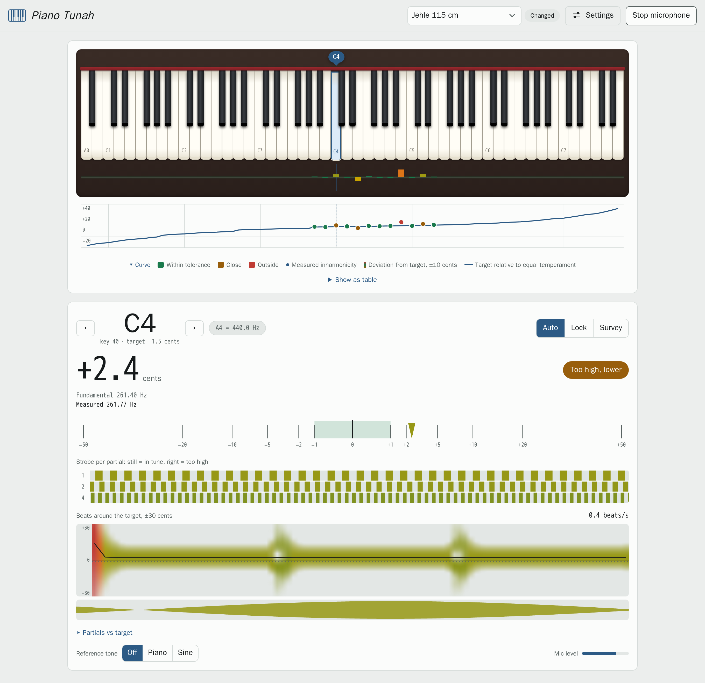
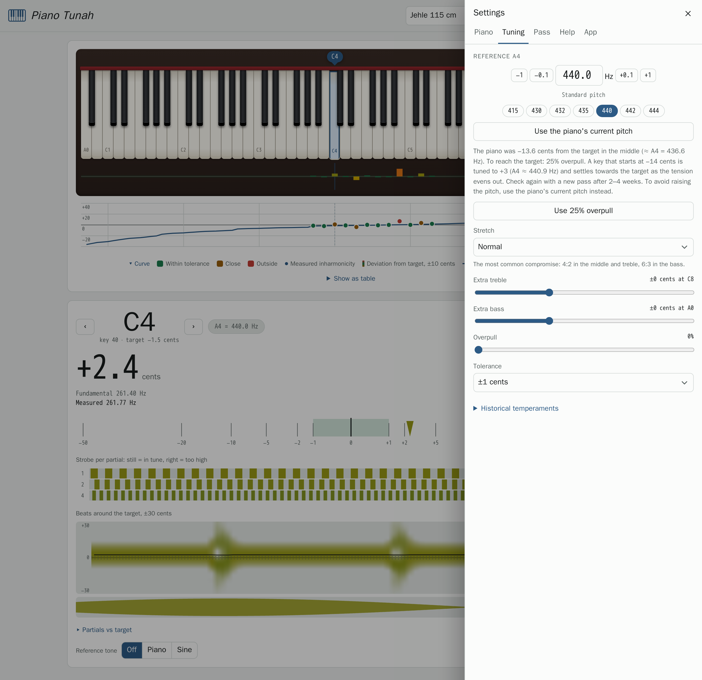

# Piano Tunah

Piano tuner in the browser. Listens through the computer's microphone, computes stretch from the strings' inharmonicity and keeps the measurements for each piano.

<picture>
  <source media="(prefers-color-scheme: dark)" srcset="docs/screenshot-dark.png">
  
</picture>

## Features

- Key detection A0–C8 and measurement to a hundredth of a cent. In the bass, partial 6, 4 or 2 is measured. Keys measured in the pass are recognised where they sound, even far from the target.
- Survey: *All A* (A0–A7) or *All keys*. Measures inharmonicity and the current pitch.
- Tuning order, optional: pitch check, pitch raise, felt strip, temperament by fourths and fifths, treble, bass, key by key. Each key lists intervals to check by ear with the beat rates the targets give, and the order moves on after two strikes in a row in tune. Step by step: [docs/tuning.md](docs/tuning.md) ([svenska](docs/tuning.sv.md)).
- Stretch with octave type 2:1–8:4 per register, Railsback curve and extra stretch at the ends.
- Temperaments: equal, Werckmeister III, Kirnberger III, Vallotti, Young II, ¼- and ⅙-comma meantone.
- Reference A4 380–480 Hz, or set from the piano's current pitch. Overpull for pitch raises, with a recommended amount when the piano is flat.
- Dial with needle and strobe rings, beat spectrogram and reference tone (piano or sine).
- A hint when a note beats, so the reading jumps: the unisons are out of tune and need muting.
- Tuning curve above the keyboard with each measured key, colored by its deviation from target, and a table.
- Upright or grand, size in cm, 85 or 88 keys.
- Tunings are saved on the server with a history per pass. Export and import as JSON.
- Recording of the microphone input as WAV, for reporting problems with the key detection.
- English and Swedish UI.

## Theory

**Inharmonicity.** A stiff string has partials above the integer multiples:

$$f_n = n f_0 \sqrt{1 + B n^2}$$

$B$ is estimated per key from the measured partials. The expression is linear in $n^2$ and solved by least squares:

$$\left(\frac{f_n}{n}\right)^2 = f_0^2 + f_0^2 B\, n^2$$

Before the piano is measured, $B$ is guessed from the instrument's size. Measured values correct the guess, and the correction (the ratio to the model, on a log scale) is interpolated between measured keys. A value more than twice, or less than half, the measured keys on both sides is taken as a misreading and left out.

**Stretch.** Octave type $p{:}q$ ($p = 2q$) makes partial $p$ of the lower note and partial $q$ of the upper note beatless. With $B_1$ for the lower and $B_2$ for the upper string, the octave is wider than 1200 cents by

$$\Delta = 1200 \log_2 \frac{g(B_1, p)}{g(B_2, q)}, \qquad g(B, n) = \sqrt{\frac{1 + B n^2}{1 + B}}$$

The temperament octave A3–A4 is laid first. Then the octaves are built up and down one at a time. Where the octave type changes, below A3 and above A4, it changes gradually over an octave so no single semitone takes the difference. Measured $B$ jumps at the breaks and varies between neighbouring strings; matched octave by octave, that would put steps of several cents between neighbouring keys, so the curve outside the temperament octave is smoothed over ±3 keys. Above C6 the treble octaves are blended towards 2:1 by C8: there the upper note's higher partials are weak, and with the large $B$ a 4:2 octave can be over 30 cents wide.

**Temperament.** A temperament is given as the deviation from a pure fifth for each of the twelve fifths. The sum is always $-\mathrm{PC}$, the Pythagorean comma (≈ 23.46 cents).

**Overpull.** When the pitch is raised, strings already tuned drop as the load on the plate and soundboard grows. Each key is tuned past the target by a share of how far it started from it: with 25%, a key at −16 cents is tuned to +4. The app recommends 25% when the middle of the piano is 10 cents or more flat.

**Beats.** A check interval beats where its lowest coincident partials meet: partial $p$ of the lower note and $q$ of the upper, 5:4 for a major third, 3:2 for a fifth. With both keys at their targets,

$$\text{beats/s} = q f_\text{hi}\, g(B_\text{hi}, q) - p f_\text{lo}\, g(B_\text{lo}, p)$$

where $f$ is the fundamental, positive for a wide interval and negative for a narrow one.

**Measurement.** An FFT (16,384 points) gives the rough position of the peaks. The frequency is then refined from the phase difference $\Delta\varphi$ between two windows offset by $H$ samples:

$$f = f_c + \frac{f_s}{2\pi H}\,\mathrm{wrap}\left(\Delta\varphi - \frac{2\pi f_c H}{f_s}\right)$$

where $\mathrm{wrap}$ puts the angle in $(-\pi, \pi]$.

<picture>
  <source media="(prefers-color-scheme: dark)" srcset="docs/settings-dark.png">
  
</picture>

## Installation

```sh
docker compose pull && docker compose up -d   # release image from ghcr.io
docker compose up -d --build                  # or build locally
```

The image is built `FROM scratch` (~7 MB) for amd64 and arm64: a static Go binary with the web app embedded. The container runs read-only as uid 1000 without capabilities, and data lives in `./data`. It listens on port 8080 over plain http, published on the host as `PIANOTUNAH_PORT` (default 8080); `http://localhost:8080` works on the same machine.

| Variable   | Default | |
|------------|---------|-|
| `ADDR`     | `:8080` | listen address |
| `DATA_DIR` | `/data` | saved pianos (JSON) |
| `DEBUG`    | unset   | set (e.g. `1`): the page sends what it does to the container log, for `docker compose logs -f` |

### Reverse proxy

Browsers only allow the microphone over https (or on `localhost`), so the app runs behind a reverse proxy. Put the proxy settings in `compose.override.yaml`; Compose loads it automatically and git ignores it. Examples in [`examples/`](examples):

- **Traefik:** `cp examples/traefik/compose.override.yaml .`, then set the hostname and the Docker network Traefik is attached to. It removes the published port.
- **Caddy:** `cp examples/caddy/compose.override.yaml .` publishes the port on localhost only; add [`examples/caddy/Caddyfile`](examples/caddy/Caddyfile) to Caddy's config. Caddy gets the certificate itself; a host that is not reachable from the internet needs the DNS challenge or `tls internal`. If Caddy runs in a container, put it on the same Docker network instead and use `reverse_proxy pianotunah:8080`.

### Install as an app

Over https the page can be installed as an app with its own window and icon: in Chrome or Edge with the install icon in the address bar, in Safari on a Mac with File → Add to Dock, and on an iPhone with Share → Add to Home Screen. Firefox cannot install web apps. An installed app has no reload button, so it says when the server runs a newer version and offers to reload.

Tests, releases and code layout: [DEVELOP.md](DEVELOP.md).

## License

Public domain ([CC0 1.0](LICENSE)). Written with [Claude](https://claude.ai) as co-programmer; use it for anything, no attribution needed.

The exception is `web/fonts/accidentals.woff2`, ♭ ♮ ♯ adapted from [Bravura Text](https://github.com/steinbergmedia/bravura) by Steinberg under the SIL Open Font License 1.1 ([web/fonts/OFL.txt](web/fonts/OFL.txt)).
