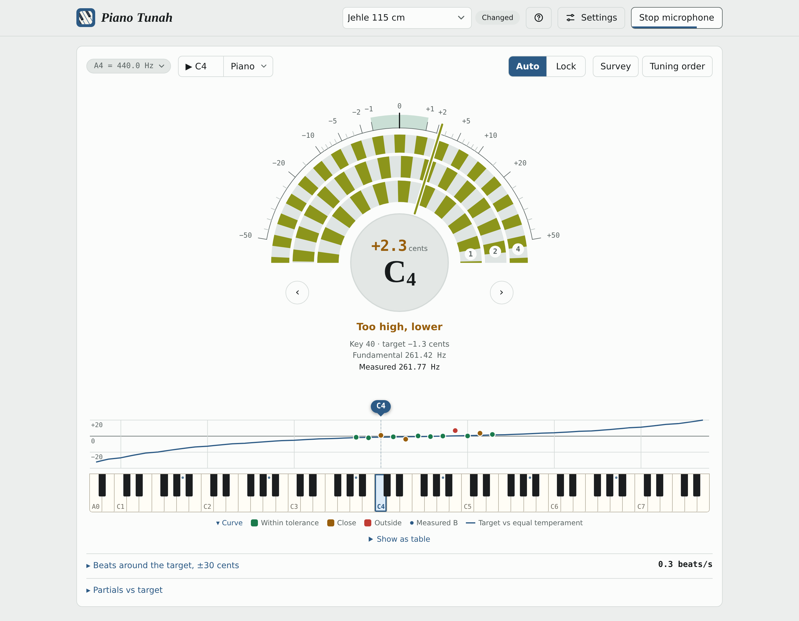
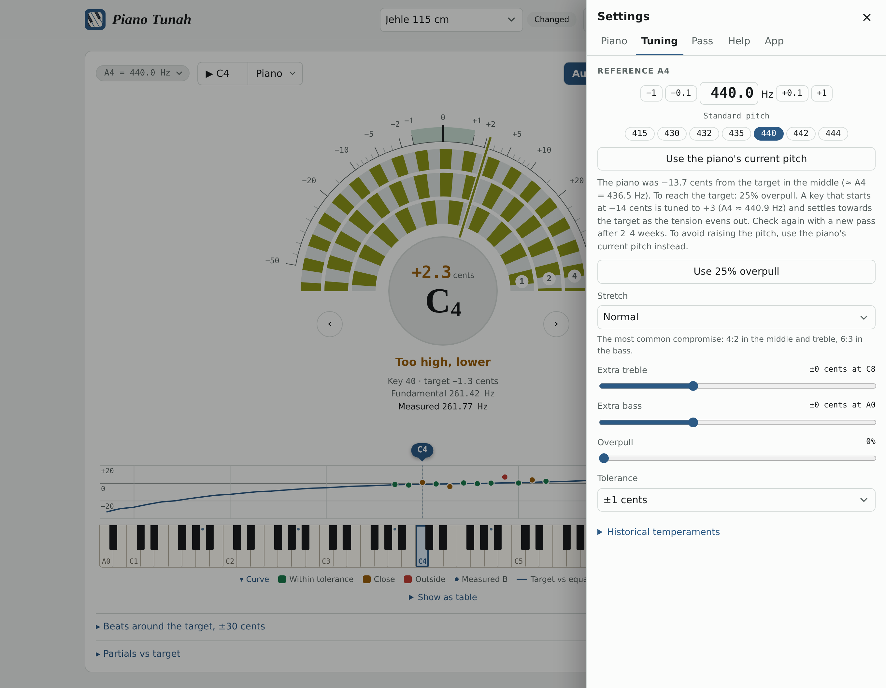

# Piano Tunah

Piano Tunah är en pianostämmare som körs i webbläsaren. Den lyssnar genom datorns mikrofon, räknar ut stretch från strängarnas inharmonicitet och sparar mätningarna för varje piano. [English](README.md).

<picture>
  <source media="(prefers-color-scheme: dark)" srcset="docs/screenshot-dark.png">
  
</picture>

## Funktioner

- Tangentigenkänning A0–C8 och mätning på en hundradels cent. I basen mäter appen delton 6, 4 eller 2. Appen känner igen tangenter som mäts i den omgång där de klingar, även långt från målet.
- En kartläggning av *Alla A* (A0–A7) eller *Alla tangenter* mäter inharmoniciteten och den nuvarande tonhöjden.
- En arbetsordning att följa om du vill: tonhöjd, grovstämning, filtremsa, temperering med kvarter och kvinter, diskant, bas, tangent för tangent. Varje tangent listar intervall att kontrollera efter gehör, med de svävningar som målen ger. Ordningen går vidare efter två anslag i rad i stäm. [docs/tuning.sv.md](docs/tuning.sv.md) beskriver varje steg ([English](docs/tuning.md)).
- Stretch med oktavtyp 2:1–8:4 per register, en Railsback-kurva och extra stretch i ändarna.
- Temperaturer: liksvävande, Werckmeister III, Kirnberger III, Vallotti, Young II, medeltonstemperatur ¼ och ⅙ komma.
- Referens A4 380–480 Hz, eller satt efter pianots nuvarande tonhöjd. Överdrag vid uppdragning, med ett föreslaget värde när pianot ligger lågt.
- Ratt med visare och strobe-ringar, svävningsspektrogram och referenston (piano eller sinus).
- När en ton svävar två gånger i sekunden eller fortare säger en ledtråd att unisonerna är ostämda och behöver dämpas. Långsammare svävningar lämnas åt örat: en ensam strängs klang pulserar också så långsamt.
- Stämkurva ovanför klaviaturen med varje mätt tangent, färgad efter avvikelsen från målet, och en tabell.
- Pianino eller flygel, storlek i cm, 85 eller 88 tangenter.
- Servern sparar stämningar med en historik per omgång. Du kan exportera och importera dem som JSON.
- Inspelning av mikrofonens ljud som WAV, för att rapportera problem med tangentigenkänningen.
- Gränssnitt på engelska och svenska.

## Teori

**Inharmonicitet.** En styv sträng har deltoner ovanför heltalsmultiplerna:

$$f_n = n f_0 \sqrt{1 + B n^2}$$

Appen skattar $B$ per tangent från de uppmätta deltonerna. Uttrycket är linjärt i $n^2$, så minsta kvadratmetoden löser det:

$$\left(\frac{f_n}{n}\right)^2 = f_0^2 + f_0^2 B\, n^2$$

Innan du har mätt pianot gissar appen $B$ från instrumentets storlek. Uppmätta värden rättar gissningen. Rättelsen är kvoten mot modellen på logaritmisk skala, och appen interpolerar den mellan mätta tangenter. Ett värde som är mer än dubbelt så stort, eller mindre än hälften så stort, som de mätta tangenterna på båda sidor räknas som en felmätning, och appen bortser från det.

**Stretch.** Oktavtypen $p{:}q$ ($p = 2q$) gör delton $p$ i den undre tonen och delton $q$ i den övre svävningsfria. Med $B_1$ för den undre och $B_2$ för den övre strängen blir oktaven bredare än 1200 cent med

$$\Delta = 1200 \log_2 \frac{g(B_1, p)}{g(B_2, q)}, \qquad g(B, n) = \sqrt{\frac{1 + B n^2}{1 + B}}$$

Appen lägger tempereringsoktaven A3–A4 först och bygger sedan oktaverna uppåt och nedåt en i taget. Där oktavtypen byter, under A3 och över A4, byter den gradvis över en oktav så att inget enskilt halvtonssteg tar hela skillnaden. Uppmätt $B$ hoppar vid brytningarna och varierar mellan närliggande strängar. Att matcha oktav för oktav skulle ge steg på flera cent mellan närliggande tangenter, så appen jämnar ut kurvan utanför tempereringsoktaven över ±3 tangenter. Ovanför C6 för appen över diskantens oktaver mot 2:1 fram till C8. Där är den övre tonens högre deltoner svaga, och med det stora $B$ kan en 4:2-oktav bli över 30 cent bred.

**Temperatur.** En temperatur anges som avvikelsen från en ren kvint för var och en av de tolv kvinterna. Summan är alltid $-\mathrm{PC}$, det pytagoreiska kommat (≈ 23,46 cent).

**Överdrag.** Vid en uppdragning sjunker strängar som redan är stämda när belastningen på ramen och resonansbotten ökar. Du stämmer varje tangent förbi målet med en andel av hur långt från målet den började: med 25 % stäms en tangent på −16 cent till +4. Appen föreslår 25 % när mitten av pianot ligger 10 cent lågt eller mer.

**Svävningar.** Ett kontrollintervall svävar där dess lägsta sammanfallande deltoner möts: delton $p$ i den undre tonen och $q$ i den övre, 5:4 för en stor ters, 3:2 för en kvint. Med båda tangenterna på sina mål blir

$$\text{svävningar/s} = q f_\text{hi}\, g(B_\text{hi}, q) - p f_\text{lo}\, g(B_\text{lo}, p)$$

där $f$ är grundtonen. Resultatet är positivt för ett vitt intervall och negativt för ett trångt.

**Mätning.** En FFT (16 384 punkter) ger topparnas ungefärliga läge. Appen förfinar sedan frekvensen från fasskillnaden $\Delta\varphi$ mellan två fönster förskjutna $H$ sampel:

$$f = f_c + \frac{f_s}{2\pi H}\,\mathrm{wrap}\left(\Delta\varphi - \frac{2\pi f_c H}{f_s}\right)$$

där $\mathrm{wrap}$ lägger vinkeln i $(-\pi, \pi]$.

<picture>
  <source media="(prefers-color-scheme: dark)" srcset="docs/settings-dark.png">
  
</picture>

## Installation

```sh
docker compose pull && docker compose up -d   # release-avbild från ghcr.io
docker compose up -d --build                  # eller bygg lokalt
```

Avbilden byggs `FROM scratch` (~7 MB) för amd64 och arm64. Den innehåller en statisk Go-binär med webbappen inbäddad. Containern körs skrivskyddad som uid 1000 utan capabilities och sparar sina data i `./data`. Den lyssnar på port 8080 över vanlig http, och Compose publicerar porten på värden som `PIANOTUNAH_PORT` (standard 8080). På samma dator öppnar du `http://localhost:8080`.

| Variabel   | Standard | |
|------------|----------|-|
| `ADDR`     | `:8080`  | adress att lyssna på |
| `DATA_DIR` | `/data`  | sparade pianon (JSON) |
| `DEBUG`    | ej satt  | satt (t.ex. `1`): sidan skickar vad den gör till containerns logg, för `docker compose logs -f` |

### Omvänd proxy

Webbläsare tillåter mikrofonen bara över https eller på `localhost`, så appen körs bakom en omvänd proxy. Lägg proxyinställningarna i `compose.override.yaml`. Compose läser in den automatiskt och git ignorerar den. [`examples/`](examples) har exempel:

- **Traefik.** Kör `cp examples/traefik/compose.override.yaml .` och ställ sedan in värdnamnet och det Docker-nätverk Traefik är kopplat till. Override-filen tar bort den publicerade porten.
- **Caddy.** Kör `cp examples/caddy/compose.override.yaml .`, som publicerar porten bara på localhost, och lägg till [`examples/caddy/Caddyfile`](examples/caddy/Caddyfile) i Caddys konfiguration. Caddy hämtar certifikatet själv. En värd som inte nås från internet behöver DNS-utmaningen eller `tls internal`. Om Caddy körs i en container lägger du den i stället på samma Docker-nätverk och använder `reverse_proxy pianotunah:8080`.

### Installera som app

Över https kan du installera sidan som en app med eget fönster och egen ikon: i Chrome eller Edge med installationsikonen i adressfältet, i Safari på Mac med Arkiv → Lägg till i Dock och på iPhone med Dela → Lägg till på hemskärmen. Firefox kan inte installera webbappar. En installerad app har ingen uppdateringsknapp, så den säger till när servern kör en nyare version och erbjuder sig att ladda om.

[DEVELOP.sv.md](DEVELOP.sv.md) beskriver tester, releaser och kodens upplägg.

## Licens

Piano Tunah är allmän egendom enligt [CC0 1.0](LICENSE). Den skrevs med [Claude](https://claude.ai) som medprogrammerare. Du får använda den till vad som helst utan att ange källa.

Undantaget är typsnittet `web/fonts/accidentals.woff2`, och samma typsnitt för Mac i `mac/PianoTunah/Fonts/Accidentals.ttf`, som har ♭ ♮ ♯ bearbetade från [Bravura Text](https://github.com/steinbergmedia/bravura) av Steinberg. Dess licens är SIL Open Font License 1.1, i [web/fonts/OFL.txt](web/fonts/OFL.txt); Mac-appen har en kopia.
